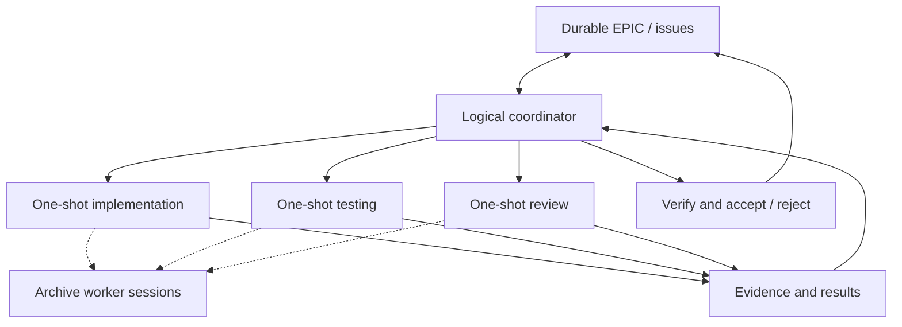

*Persistent coordination. Ephemeral execution. Durable evidence.*

We have been building AI agents as though they are employees.

We give them long-running sessions, persistent responsibilities and an ever-expanding list of things to do. Then we wonder why their context fills up, why decisions drift, and why so much of the token budget disappears without a corresponding improvement in delivery.

There is a simpler way to think about it.

**The intelligence does not need to persist. The work does.**

## Why are we paying for yesterday's task again?

The most immediate problem with reusing the same subagent is not philosophical. It is computational.

A worker finishes Task A. Its conversation now contains the instructions, files, tool outputs, failed approaches, diagnostics and final report for Task A. We then give the same worker Task B. Depending on how the runtime manages context, much or all of that previous history can be sent through the model again, even though Task B does not require it.

Finish Task B, add Task C, and the burden grows.

In a simple illustrative model, suppose every task introduces 10,000 tokens of history, all of which are retained and reprocessed on subsequent tasks. Over ten tasks, the cumulative history processed is:

| Task | History carried into the next task |
| --- | ---: |
| 1 | 10,000 tokens |
| 2 | 20,000 tokens |
| 5 | 50,000 tokens |
| 10 | 100,000 tokens |

If that growing history is processed once per task, the total across ten tasks is 550,000 tokens of accumulated context, compared with 100,000 tokens for ten independent 10,000-token tasks—*before* considering common instructions, model-specific caching, truncation, summarisation and other runtime behaviour. This is an illustration, not a measured benchmark or universal billing prediction.

The exact cost depends on the model, prompt caching, context management and what gets retained. But the architectural problem remains: **unrelated history can be repeatedly carried forward for no useful reason.**

That is a poor way to spend a finite token budget.

And cost is only half the problem. Each old instruction and abandoned hypothesis competes for attention with the work that actually matters now. Bigger context is not automatically better context.

## The persistent-agent trap

A long-running agent is useful when the *objective itself* requires ongoing responsibility. A project needs decisions, sequencing, dependencies, status and continuity.

But keeping every execution worker alive turns a clean delivery system into a growing collection of conversations. You gradually acquire duplicated ownership, stale assumptions, hidden work queues and unresolved intentions. A worker starts as a tester and, three assignments later, is also changing the architecture.

You have not created a better team. You have created more places where project state can become trapped.

The answer is to separate **coordination** from **execution**.

## One coordinator, disposable workers

A project has one logical coordinator for an objective or EPIC. It owns priorities, task boundaries, delegation, integration and acceptance. The coordinator session can itself be replaced when needed, but the logical ownership and delivery state survive in durable records.

A subagent gets **one bounded assignment**. It receives only what it needs: objective, issue, relevant baseline, permitted scope, acceptance criteria, validation commands and expected evidence.

It performs the work, returns the result, and closes. It does not inherit unrelated tasks, collect an open-ended schedule or silently become another coordinator.



Parallelism is allowed where workers have explicit boundaries and do not collide in their changes. The key is **one accountable coordinator, not an invisible pyramid of persistent agents**.

## One assignment, not one tool call

One-shot does not mean a subagent only gets a single prompt or tool call. It can run commands, write code, test, diagnose and iterate *within its assigned scope*.

A task contract might look like this:

```text
Task: JAVA-WRAPPER-014
Execution: JAVA-WRAPPER-014/attempt-1
Baseline: <full commit SHA>
Objective: Launch a supplied JAR with validated arguments
Scope: Java wrapper module and its tests
Acceptance: CLI behaviour, exit-code propagation, test evidence
Return: commits, changed files, test results, risks
Expiry: governed time/resource boundary
```

After it returns, the coordinator independently verifies whether the result meets acceptance criteria. Completion is not the same as acceptance. If the worker failed, or the evidence fails review, the coordinator records what happened and starts a *new bounded execution* with the relevant findings.

Starting fresh must not become a loophole for repeating the same failed strategy. The governed circuit breaker still applies.

## Persist useful information, not the entire conversation

This is the crucial distinction.

The next worker might genuinely need to know that a test failed, that a particular design was rejected, or that a public contract cannot change. It does **not** need 80 pages of chat history showing how the previous worker discovered those facts.

Persist the distilled evidence: the requirement, baseline, commits, test outputs, relevant diagnostics, failed hypotheses, decisions and next steps.

Then build the next worker's context from those authoritative artifacts.

The durable system becomes the memory. The workers remain disposable.

## Failure becomes a bounded event

If a worker stalls or exhausts its context, terminate or close that execution and preserve its disposition. Another worker can take the assignment from the last verified state without relying on a mysterious previous conversation.

That requires more than a good prompt. Each dispatch needs a unique execution ID, bounded lifetime and clear write ownership. Before retrying, the coordinator checks whether the earlier execution already changed files or triggered side effects. Otherwise, a delayed worker and its replacement can both apply the same change.

If the runtime does not support actual lease revocation or archival, the coordinator should record that limitation and enforce the closest possible boundary through tracked status and controlled write access. A governance document must not pretend a mechanism exists when it does not.

## Does starting fresh always save tokens?

No. A new agent may have to reread the same large codebase or rebuild its environment. Prompt caching can also reduce the price of repeated shared context. For a tightly coupled, short sequence of related actions, continuing a bounded worker may be more efficient than restarting after each tool call.

The goal is not maximum agent turnover. It is **minimum irrelevant context per verified outcome**.

That means choosing task boundaries that produce meaningful, independently reviewable results. A worker can spend time on one coherent task. It should not carry its last ten unrelated jobs into the eleventh.

## Archive the worker; keep the proof

A returned worker is not a permanent member of the team. Its result is an artifact for the coordinator to evaluate.

Archive the execution after its outputs and disposition are recorded—even when it failed. Archiving does not erase logs or evidence. It ends the worker's ability to keep acting as an ongoing collaborator.

The coordinator's own continuity follows the same principle. Before a session handoff, preserve the EPIC, open issues, in-flight executions, decisions and next actions. A successor session reconstructs the work from those records. There should never be two competing coordinators for the same objective.

## What we added to VibeGov

We formalised this approach in [GOV-11: Ephemeral Subagent Execution](https://github.com/governance-foundation/vibegov.io/blob/main/.governance/rules/gov-11-ephemeral-subagent-execution.mdc).

The rule requires one-shot task contracts, durable evidence, coordinator-owned verification, worker archival, safe retries and explicit handoff semantics. It expresses an architectural contract; individual runtimes still need to implement and verify the relevant enforcement mechanisms.

This builds on [Explicit Orchestration Beats Hidden Agent Pyramids](/blog/explicit-orchestration-bounded-work), and responds to the delivery risk explored in [Bankruptcy by Monday Morning](/blog/bankruptcy-by-monday-morning-modern-poc-trap).

## Design for throughput, not conversation longevity

The unit of value in an autonomous software factory is not a busy agent or a long transcript. It is a requirement that has moved into a verified state.

We should not celebrate how many agents are still running. We should ask how much irrelevant history they are carrying, what each one owns, what evidence it returns, and how safely the work can resume when it disappears.

Keep the coordinator's responsibility continuous. Keep the worker's assignment bounded. Keep the evidence durable.

**Stop keeping your AI agents alive just to remember work that belongs in the repository.**

Do not just prompt the machine.

Conduct it.
